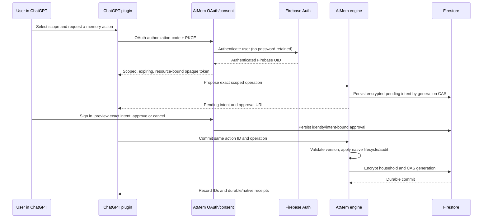

# Architecture, authority and threat model

## Data and consent flow

ChatGPT is the only product UI. The sign-in, OAuth consent and exact-operation
approval pages are required authentication controls, not an app dashboard.
No chat history or model output is captured in the background.

## Storage and encryption

AtMem Memory/SQLiteStore remains the authority for facts, episodes, graph/FTS,
corrections, supersession, exclusions and native audit/deletion receipts. Cloud
persistence is an adapter around a closed, checkpointed household snapshot.
An account's Firebase UID is resolved from authenticated OAuth, mapped to keyed
opaque Firestore IDs, and never accepted from a tool. Personal/project subject
IDs are derived within that account and membership checked before every read.

A request loads the exact generation/chunks inside a Firestore transaction,
opens private temporary SQLCipher storage and runs native AtMem methods. The
closed encrypted database and policy are packed into a versioned household,
AES-256-GCM sealed with purpose-bound AAD, split into <=256 KiB chunks, and
published by generation compare-and-swap. No successful tool write precedes CAS.
A missing chunk, bad authentication tag or unknown format fails closed.
A lost commit reply leaves possibly active chunks intact. Retrying the intent
returns its persisted result instead of duplicating memory. Old chunks are
removed separately after CAS; cleanup failure is reported, not hidden.

This is a bounded first cloud backend, **not native Firestore indexed retrieval**.
Reads that audit also produce a new snapshot. Conflicting reads/writes may need
retry, and Firestore cost grows with snapshot size. There are no production
latency/scale/availability claims. No vector service, remote embedding provider
or LLM call is required; auto-vectors are disabled for this surface. No ephemeral
Cloud Run filesystem, Firestore mirror or provider reranker becomes an authority.

Keys are operator-owned. SQLCipher encrypts DB/WAL; AES-GCM seals Firestore
snapshots/control records. Key derivation separates purposes. TLS protects
approved production transport. This is not E2EE/zero knowledge, FIPS validation
or a new post-quantum/full-fidelity evidence guarantee. No host transcript capture
is supplied by this plugin. Storage admins who also obtain the key can decrypt.
The default local AtMem installation is not silently converted to encryption.

## Permission matrix

| Path | Required authority | Additional gate |
|---|---|---|
| Discovery/health | Public metadata only | Host/origin/body/rate validation |
| list/search/read/activity/receipt | OAuth memory:read | Account-owned exact scope |
| propose save/correction/project | OAuth memory:write + read | Screening, bounds, idempotency |
| preview exact delete | OAuth memory:delete + read | Exact active ID/version |
| approve/cancel | Independently authenticated human browser | Same UID, CSRF, exact preview and expiry |
| commit save/correct/project | OAuth memory:write + read | Same immutable approved operation; current revision |
| commit delete | OAuth memory:delete + read | Same immutable approved operation; current revision |
| Server DB access | Dedicated service IAM | No browser/client Firestore access |
| Reviewer | Dedicated synthetic account | No owner/other-user data |

OAuth uses exact provided clients and callbacks, code+PKCE S256, explicit
resource binding, hashed credential IDs and encrypted control records, short
access TTL, rotating single-use refresh and revocation of the grant family.
CIMD/DCR is deliberately not advertised. SDK compatibility details and package
schema discrepancy are recorded in the feature research. User approval must
not be model-supplied; there is no MCP approve endpoint or approval boolean.

## Threats and controls

| Threat | Control and remaining limit |
|---|---|
| Cross-user/project access | Derived identity, separate households, scope membership and exact-ID checks; IAM/operator trust remains essential |
| Injection/credential capture | Existing untrusted-proposal screening, HTML escaping, untrusted output labels, no automatic execution; host/model behavior still requires real account tests |
| Forged consent | Human Firebase login, signed HttpOnly session, exact preview, CSRF and origin/expiry checks; user must protect account/session |
| Concurrent update/replay | Intent hash/idempotency key, record revision, atomic engine+intent state and generation CAS |
| Stolen database/chunks | SQLCipher + AES-GCM; key custody/recovery is operator responsibility |
| Revoked/expired auth | Grant validation on each request and immediate OAuth revocation; registered accounts revalidate with Firebase on refresh, with <=10 min active-token and <=5 min browser-session windows |
| Offline/unknown write outcome | No success before durability, exact-intent retry and persisted receipt; no fallback into native local memory |
| Quota/abuse | Verified-email registration (or invited policy), email delivery throttles, snapshot/record/scope/pending/body limits and per-peer process rate limiter; upstream Cloud Run/IAM quotas are still needed; these are not spend caps |
| Leftover data | Lazy draft purge, expired-control TTL/maintenance, obsolete-generation cleanup; provider backups/PITR and external ChatGPT copies remain separate |
| Logging disclosure | Application access logs disabled; no deliberate token/password/content logs. Cloud Run provider request logs can contain URLs/operation references (30-day default retention verified); bodies/credentials are not deliberately logged. Raw synthetic traces stay outside the ZIP |

All content is readable with semantic HTML, labelled forms and keyboard controls.
No essential workflow relies on hover, motion or JavaScript in consent pages.
Real local browser tests exercise the sign-in/preview pages, axe accessibility,
keyboard approval and no-JavaScript form access. Deployed-service and actual
ChatGPT accessibility/confirmation testing remain separate release gates.

## Registered Firebase accounts
The default access policy remains invited. `access_policy=registered` enables
registration only within a live OAuth connection request. Firebase creates the
account and sends verification; the service does not grant an OAuth code until
Firebase's trusted sign-in response confirms the email is verified. Registration
alone never creates memories or connects ChatGPT. Email delivery is throttled
atomically per normalized address (120 s) using opaque HMAC IDs and per observed
peer (5 account-email submissions/minute). Firebase quotas also apply. Large public
launches need measured abuse controls; these pilot limits are not a CAPTCHA.

Passwords pass to Firebase over TLS, never into AtMem. Firebase refresh credentials
needed to revalidate registered accounts on plugin OAuth refresh are held in the
encrypted control store, not returned to ChatGPT. Disabled/deleted/changed Firebase
accounts cannot refresh plugin access. Existing access tokens last at most ten
minutes; existing independent browser approval sessions at most five minutes.
Revoke the plugin OAuth grant for immediate invalidation of that grant. Account
registration, password reset and verification resend never expose memory content.
The cloud data-flow acknowledgement is required by this registration form; OAuth
scope consent and per-operation approval are independent server-enforced gates.
